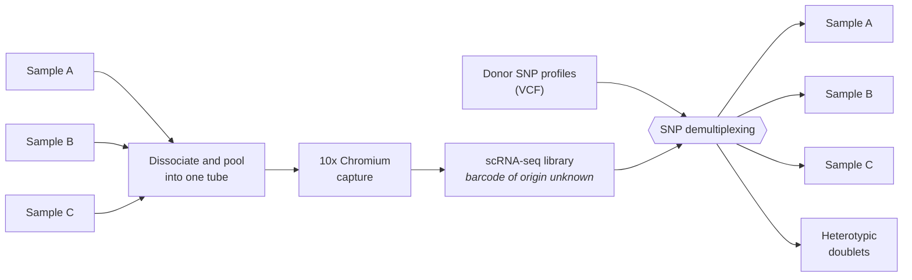
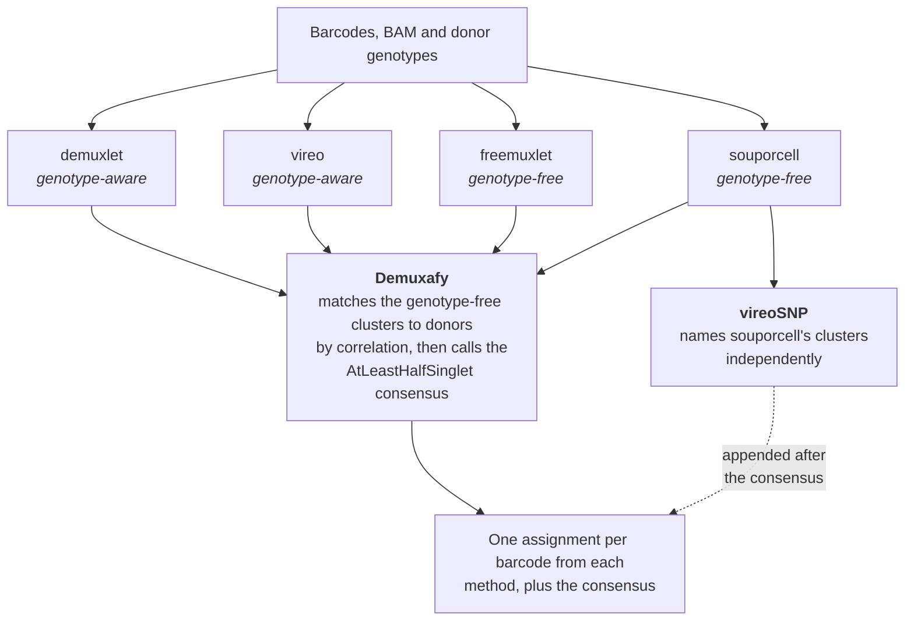
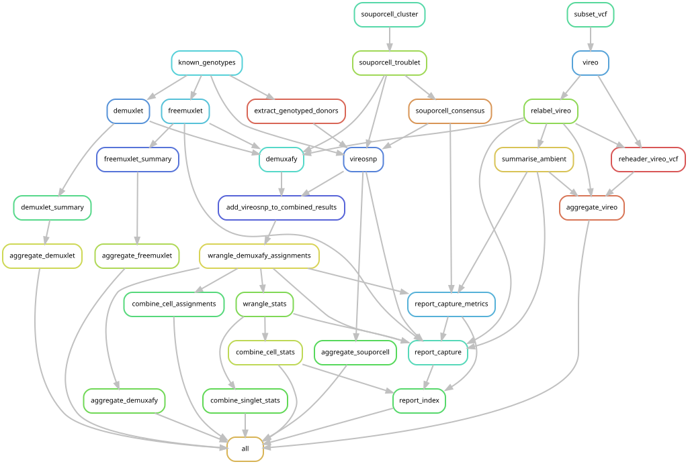
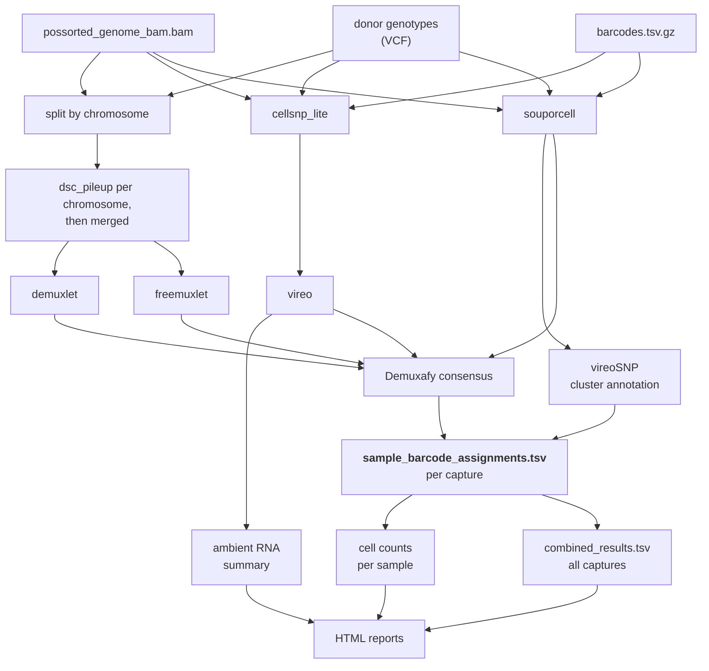

# SNP Demux

This workflow demultiplexes "pooled captures".
A "pooled capture" is when multiple tissues samples are dissociated into single cells together in the same test tube, and then captured together using the 10X Chromium platform to generate scRNA-seq libraries.



When these libraries are sequenced, it is not obvious which cell barcode came from which sample.
But by utilizing SNP profiles for each sample in the pool, we can attempt to demultiplex the capture by assigning each barcode to an individual sample.
We can also use SNP information to detect "heterotypic doublets", where a barcode represents a doublet of two cells, each from a different sample.

## Contributions

This workflow is a simplification and refactoring of the [demuxafy](https://github.com/swarbricklab/demuxafy) workflow developed by [Daniel Roden](https://github.com/dlroden) and [Beata Kiedik](https://github.com/BeataKiedik). 
The demuxafy workflow is, in turn, a Snakemake wrapper around the [Demuxafy](https://demultiplexing-doublet-detecting-docs.readthedocs.io/en/latest/index.html) package and tools developed by [Drew Neavin](https://github.com/drneavin) at the Powell Lab.

The main difference between this workflow and the [demuxafy](https://github.com/swarbricklab/demuxafy) workflow is that several phases have been factored out into separate, reusable workflows that are prerequisites for this one:

- [genotyping](https://github.com/swarbricklab/genotyping) and [imputation](https://github.com/swarbricklab/imputation) — build the donor SNP-genotype panel;
- [sc_pileup](https://github.com/swarbricklab/sc_pileup) — the expensive, deterministic **per-cell pileup** (cellSNP-lite, popscle `dsc-pileup`, souporcell `vartrix`). snp_demux no longer computes pileups: it **consumes sc_pileup's outputs** and runs only the (comparatively fast) demultiplexing + consensus. This means the pileups can be frozen and the demux re-run and re-tuned cheaply, and it greatly simplifies this workflow's rule graph (see below).

## Method

Briefly, this workflow runs four well-established SNP demux methods in parallel and then uses [Demuxafy](https://demultiplexing-doublet-detecting-docs.readthedocs.io/en/latest/index.html) to call doublets and find a consensus sample-barcode assignment.
The four methods are
1. vireo [docs](https://vireosnp.readthedocs.io/en/latest/)| [paper](https://genomebiology.biomedcentral.com/articles/10.1186/s13059-019-1865-2) | [GitHub](https://github.com/single-cell-genetics/vireo)
2. souporcell [paper](https://www.nature.com/articles/s41592-020-0820-1) | [GitHub](https://github.com/wheaton5/souporcell)
3. demuxlet [docs](https://github.com/statgen/demuxlet/blob/master/tutorial/README.MD) | [paper](https://www.nature.com/articles/nbt.4042) | [GitHub](https://github.com/statgen/demuxlet)
4. freemuxlet [GitHub](https://github.com/statgen/popscle)

See the links above for details on the algorithms used by each of these methods.

The results of each method are combined using Demuxafy's [AtLeastHalfSinglet](https://demultiplexing-doublet-detecting-docs.readthedocs.io/en/latest/CombineResults.html) option, but there is scope to extend this workflow to include other options for combining results.

### souporcell cluster annotation

souporcell is genotype-free: it clusters barcodes by SNP profile but cannot name the clusters.
The workflow maps those clusters onto the known donor genotypes twice, by two independent routes:

1. Demuxafy's own correlation-based matching, which feeds the consensus above.
2. [vireoSNP](https://vireosnp.readthedocs.io/en/latest/), which scores each cluster against each donor genotype and is run separately.

The vireoSNP annotation is appended to the combined results as an additional assignment column *after* the consensus has been called, so it does not influence it.
The barcode-level output therefore carries five assignments per cell — `Demuxlet`, `Freemuxlet`, `Souporcell`, `Vireo` and `Souporcell_vireosnp` — plus the `AtLeastHalfSinglet` consensus over the first four.
Treating vireoSNP as a fifth opinion is useful when reviewing a capture: it is the only assignment derived from a genotype-free clustering that was named after the fact.

### Ambient RNA

vireo estimates the fraction of ambient RNA per barcode as a by-product of assignment.
The workflow summarises this per capture into a distribution over bins, which is a useful first check when a capture has an unexpectedly high doublet rate or a low singlet fraction.

At a high level of abstraction, the overall processing flow is as follows:



### Rule graph

Because the pileups are produced upstream by [sc_pileup](https://github.com/swarbricklab/sc_pileup)
and consumed here, the rule graph contains **only** the demultiplexing, consensus,
aggregation and reporting rules — no per-cell pileup, per-chromosome split, or
merge rules:



Each engine reads sc_pileup's output for the capture (`cellSNP.*` for vireo,
`pileup.{cel,var,plp,umi}.gz` for demuxlet/freemuxlet, `ref/alt.mtx` for
souporcell) and the per-pool donor-genotype panel; nothing re-reads the BAM.

## Requirements

This workflow requires, per capture:
1. **sc_pileup outputs** — the per-cell pileups produced by [sc_pileup](https://github.com/swarbricklab/sc_pileup) (cellSNP-lite, popscle `dsc-pileup`, souporcell `vartrix`), under `deps.pileup_root`.
2. **A per-pool donor-genotype panel** — the donors' SNP profiles at the piled sites, as `deps.panel_root/<capture>/informative.vcf.gz` (bgzipped + `.csi`-indexed).

The cellranger `barcodes.tsv.gz` and `possorted_genome_bam.bam` are inputs to **sc_pileup** (which reads the BAM once to build the pileups); snp_demux itself never re-reads the BAM. Run [sc_pileup](https://github.com/swarbricklab/sc_pileup) first against the panel's sites, then point `deps.pileup_root` at its output root.

Before running, make sure the panel and BAM satisfy the tool requirements (all-autosome coverage, matching contig order, a populated `R2` field for demuxlet) — see [`docs/data_prep_requirements.md`](docs/data_prep_requirements.md).

### `cellranger` barcodes (for sc_pileup)

sc_pileup takes the following `cellranger` "outs":
1. `barcodes.tsv.gz`
2. `possorted_genome_bam.bam`

In particular, the `barcodes.tsv.gz` file under `filtered_bc_matrix` should be preferred over the `raw_bc_matrix`, because `cellranger` filters out empty droplets and other low-quality barcodes.
Excluding these barcodes should improve the performance and accuracy of this workflow.

> Theoretically, it may be possible to further improve performance and accuracy by further filtering the barcode list, based on criteria such as gene counts, mitochondrial content or other doublet detection methods.
> However this theoretical benefit has not been benchmarked.

### VCF file

This workflow has been tested with SNP profiles based on microarray data.
Raw microarray data (`.CEL` files) for each donor sample can be aggregated into an appropriate VCF file via the [genotyping](https://github.com/swarbricklab/genotyping) workflow. 
The resulting VCF can be used directly as an input to this workflow.
Alternatively, additional SNPs can be imputed based on the 1000 Genomes project via the [imputation](https://github.com/swarbricklab/imputation) workflow.
Imputation provides more SNPs and therefore a better chance of finding matching reads in sparse scRNA-seq data, which [apparently](https://demultiplexing-doublet-detecting-docs.readthedocs.io/_/downloads/en/v0.0.3/pdf/) yields better results but we have not benchmarked this.


> (*) Note that SNP profiles do not have to be generated from the same tissue as the sample being demultiplexed.
> We get good results with other tissues from the same donor, including blood samples.

Our experience so far is with SNP profiles based on SNP microarrays, but theoretically VCF files derived from whole genome sequencing should also work, if appropriately filtered to exclude non-SNP variants.

> Note: make sure that the chromosome notation (`chr1`, `chr2`, .. versus `1`, `2`, ...) in the VCF file matches that used by the reference transcriptome specified with `cellranger`.

## Configuration

The workflow is driven by a single config file, passed with `--configfile`.
See [`config/template_config.yaml`](config/template_config.yaml) for a starting point.

| Key | Meaning |
| --- | --- |
| `deps.samples` | Sample sheet: which samples are in which capture (see below) |
| `deps.captures` | Capture sheet: one row per capture (see below) |
| `deps.pileup_root` | Root of the sc_pileup outputs consumed here: `<pileup_root>/<engine>/<platform>/<capture>/` |
| `deps.panel_root` | Per-pool donor-genotype panels: `<panel_root>/<capture>/informative.vcf.gz`. Defaults to `<pileup_root>/panel` |
| `deps.default_platform` | Platform used when a capture row has no `platform` column (default `short`) |
| `deps.vcf` | Legacy cohort donor VCF; retained for reference. Donor genotypes now come per-capture from the panel above |
| `outs.root` | Root for all data outputs |
| `outs.logs` | Root for per-rule logs |
| `outs.reports` | Optional. Where the HTML reports are written; defaults to `<outs.root>/report` |
| `params.cellsnp_lite` | Legacy pileup thresholds; the pileup is now done upstream in sc_pileup, so these are unused here |
| `params.demuxlet` | `coeff` and `offset` for the demuxlet doublet prior |
| `params.demuxafy` | Correlation limits for matching souporcell and freemuxlet clusters to donors, and the agreement threshold for the consensus |
| `ref.souporcell.genome_fasta` | Reference genome FASTA, matching the transcriptome used by `cellranger` |
| `containers.*` | Per-tool container images (replaces the old monolithic Demuxafy.sif): `bcftools`, `popscle` (demuxlet/freemuxlet), `vireo` (demux CLI), `vireosnp` (souporcell-genotyping + cell counts), `souporcell`, `r` (all R/Rmd rules), `demuxafy` (consensus/summary/assign scripts). See `config/template_config.yaml` and the recipes under [`containers/`](containers) |

Set `outs.reports` when the reports should be published alongside a dataset's other reports rather than buried in the data tree.
For example, in a dataset repository:

```yaml
outs:
  root: data/snp/demux/
  logs: logs/snp/demux
  reports: reports/snp_demux
```

### Sample sheets

`captures.csv` — one row per capture:

```csv
capture_id,pool_id,barcodes,bam,cells_captured,possible_live_cells
Mixed_1,Mixed_1,path/to/barcodes.tsv.gz,path/to/possorted_genome_bam.bam,15000,12000
```

`pool_id` is optional and is used only to group captures in the reports.
Leave it blank if the captures are not organised into named pools.
`cells_captured` and `possible_live_cells` are carried for provenance and are not read by the workflow.

`samples.csv` — one row per sample per capture:

```csv
sample_id,donor_id,capture_id
DONOR_1,DONOR_1,Mixed_1
DONOR_2,DONOR_2,Mixed_1
```

`sample_id` identifies the sample in the pool; `donor_id` identifies the genotype in the VCF.
These differ when several samples come from one donor, for example a primary and a metastasis.
The number of rows for a capture sets the number of clusters souporcell, freemuxlet and vireo are told to look for, so this sheet must be complete.

The donor-genotype panel and the BAM must satisfy a few tool requirements (all-autosome
coverage, matching contig order, a populated `R2` field for demuxlet) — see
[`docs/data_prep_requirements.md`](docs/data_prep_requirements.md).

## Running

This module is defined as a [Snakemake](https://snakemake.readthedocs.io/en/v7.32.3/) workflow.
The pipeline is roughly as follows.
This is a simplification: each box stands for a group of rules, and the
per-chromosome fan-out and merge steps are collapsed.



Run it from the root of the dataset repository:

```bash
bash modules/snp_demux/run_mod.sh
```

On NCI, `run_mod.sh` loads `singularity`, activates the `snakemake_7.32.4` environment and selects the cluster profiles under [`profiles/`](profiles), which submit each job to PBS.
Elsewhere it runs locally.
Any additional arguments are passed through to `snakemake`, so `--dry-run`, `--until` and friends work as usual.

The DAG is large — well over a hundred jobs per capture — so build it on a compute node rather than a login node.

After `snakemake` finishes, `run_mod.sh` does two clean-up steps:

1. Deletes the empty placeholder PNGs that `relabel_vireo` creates to trigger downstream rules when a capture has no unknown genotypes.
2. Appends the per-rule logs to `<outs.logs>.tar.gz` and removes the directory. This workflow produces tens of thousands of small log files, which is a real problem on a shared filesystem with an inode quota. The archive is appended to, not recreated, so an incremental run keeps the logs of every capture run previously.

## Outputs

```
<outs.root>/
  demuxlet/<capture_id>/          per-method results
  freemuxlet/<capture_id>/
  souporcell/<capture_id>/
  souporcell/annotation/vireosnp/<capture_id>/
  vireo/<capture_id>/
    ambient_stats.csv             ambient RNA fraction, binned
    ambient_summary.csv
    ambient_plot.png
  assignment/<capture_id>/
    sample_barcode_assignments.tsv  one row per barcode, all five methods plus consensus
    cell_assignment.tsv
    all_cells_stats.tsv             cells per sample, including doublet and unassigned
    all_singlets_stats.tsv          cells per sample, singlets only
  assignment/report/
    combined_results.tsv            all captures, stamped with capture_id
    all_cells_stats_full.tsv
    all_singlets_stats_full.tsv
```

`sample_barcode_assignments.tsv` is the main result.

> Note on reading these files: sample ids are frequently bare digits, so a TSV
> reader left to infer types will read `sample_id` as numeric for some captures
> and character for others, and the two then refuse to join. Always declare the
> expected column types.

## Reports

The workflow renders a set of linked HTML pages under `outs.reports`:

```
<outs.reports>/
  index.html
  captures/<capture_id>.html
  metrics/<capture_id>.tsv
```

`index.html` is the landing page:

- **Overview** — singlet fraction across all captures, and a callout naming any declared sample that was not recovered as a singlet.
- **By capture** — one row per capture.
- **By sample** — one row per sample per capture, so searching a sample id finds every capture it appears in, plus a listing of samples spanning more than one capture.

Both tables are filterable per column and export to CSV, and every capture id links through to its page.

Each capture page covers:

- **Summary** — barcodes, singlets, doublets, unassigned, samples declared vs recovered, ambient RNA.
- **Cell counts by sample** — as a share of all barcodes and as a share of singlets.
- **Ambient RNA** — the binned distribution, plus vireo's genotype-distance figure.
- **Agreement between methods** — the calls each method made, how many methods back the consensus for each barcode, and the pairwise concordance between methods.
- **Method diagnostics** — the freemuxlet correlation and vireoSNP matching heatmaps.

Figures are embedded rather than linked, so a capture page can be sent on its own.

The `metrics/<capture_id>.tsv` files are the per-capture roll-up that both the capture page and the index read, so the two cannot disagree.

## Reproducibility

Every rule runs in a pinned container (the Demuxafy-toolchain images are pinned to
the exact versions the retired `Demuxafy.sif` shipped), and all demultiplexing
**calls** reproduce byte-for-byte given the same frozen pileups + panel. The one
output that is *not* bit-reproducible is vireo's ambient-RNA proportion QC
(`--callAmbientRNAs` uses multithreaded, non-associative float reductions) — it
does not affect any donor assignment. See
[`docs/reproducibility.md`](docs/reproducibility.md) for the container pins, the
full list of what is / isn't reproducible, and how the container split was
verified against the `Demuxafy.sif` baseline.
